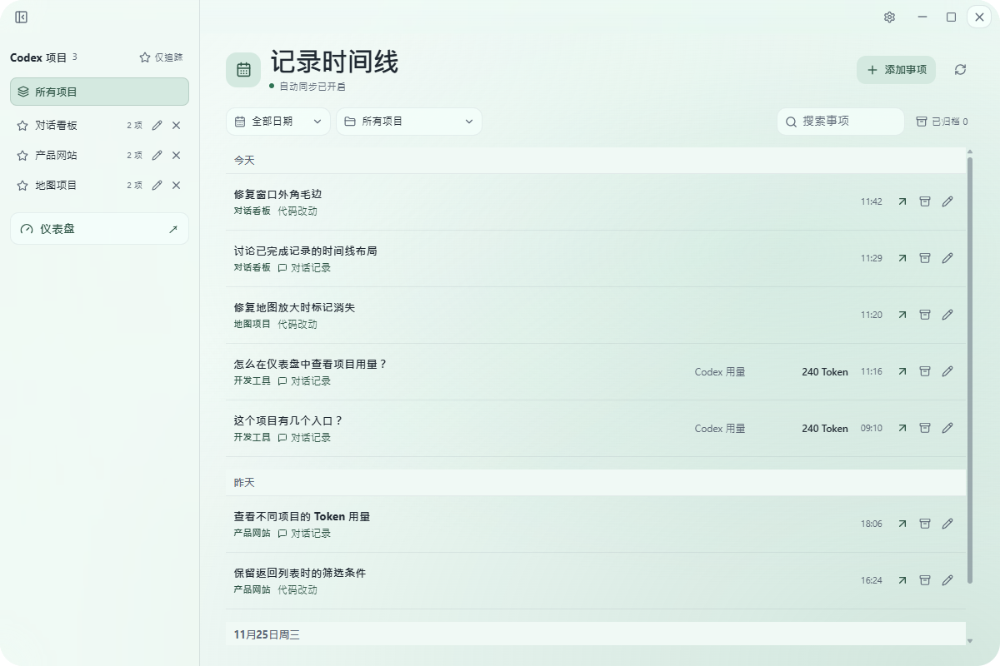

# Codex 对话看板

把 Codex 对话里的代码改动、待办和提醒汇到一块看板。按项目跟进事项、把提示词发回 Codex，并在仪表盘查看项目用量、日进度和重复需求。

**Windows 便携应用** · React + TypeScript · Tauri + Rust · SQLite

[快速开始](#快速开始) · [日常使用](#日常使用) · [项目仪表盘](#项目仪表盘) · [外观](#外观) · [同步与数据](#同步与数据) · [开发与构建](#开发与构建)



*上图使用示例项目和会话。*

## 快速开始

1. 在装有 WebView2 的 Windows 上解压项目包，双击仓库附带的 [conversation-board.exe](portable/conversation-board.exe)。下文的功能以当前源码[构建的便携版](#构建便携版)为准。
2. 点击顶部的「添加事项」，输入要交给 Codex 的提示词。可以先保存，也可以直接发送。
3. 安装并登录 Codex 桌面版。看板启动时会自动开启「对话同步」。首次安装会话钩子后，按看板设置里的提示重启 Codex。

## 日常使用

| 要做什么 | 在哪里操作 |
| --- | --- |
| 聚焦项目 | 在左侧选择 Codex 项目，用星标追踪常用项目。顶部可以按同步日期和关键词筛选事项。 |
| 跟进事项 | 首页按日期展示所有记录。点击事项可编辑标题和备注，有同步来源时可展开查看依据。 |
| 查阅普通对话 | 纯问答和讨论会按轮次显示在时间线中，标记为「对话记录」。可从记录回到 Codex 原会话。 |
| 发给 Codex | 添加事项时，或在可发送的事项上，选择「开启新对话」或「沿用之前对话」。用「在 Codex 中查看」回到关联对话。 |
| 归档与恢复 | 点击卡片上的归档按钮。需要恢复时，从顶部「已归档」进入历史列表。 |
| 接收提醒 | 开启对话同步并配置 API 后，可以在 Codex 对话中明确提出提醒。看板运行时会投递到期的 Windows 通知。 |

最小化后，看板在 Windows 通知区域继续同步。单击托盘图标恢复窗口，也可右键退出。在「设置 → 关闭窗口时」选择每次询问、最小化到托盘或直接关闭。

## 项目仪表盘

点击左侧项目列表下方的「仪表盘」。

| 卡片 | 能看到什么 |
| --- | --- |
| 项目用量占比 | 汇总可归属项目的本地 Codex 对话，包括归档对话以及纯问答和讨论。支持今天、近 7 天、近 30 天、全部日期和自定义范围。按轮次的本地结束日期累计 Token，同一对话在选中范围内计一次。 |
| 项目日进度 | 选择日期，查看当天同步或完成的事项。按项目分组，每组按时间排列，长列表可在卡片内滚动。 |
| 重复问题雷达 | 选择项目，查看同步记录中改动次数最多的 6 个文件。 |

点击雷达下方的「分析重复需求」，将所选项目近期最多 80 条用户请求的文本片段发送到已配置的 API。结果会把不同说法的同一需求归在一起，列出提及次数和可展开核对的原句。

## 外观

在「设置 → 主题色」选择预设色块，或用 RGB 滑块和数值输入微调。调整时可实时预览，点「保存主题」后，可从「已保存的主题」点选配色再次使用。在「管理」中选择一个已保存的主题，即可编辑配色或删除。深色模式可单独切换。

在「设置 → 外观」关闭「显示 Codex 额度」可隐藏卡片上的额度条，Token 用量仍会显示。

## 同步与数据

- **对话同步**在本机安装 Codex 会话钩子，记录代码改动和普通对话。升级时也会从本地日志补录此前已同步、尚无卡片的普通对话。同步失败时，可在设置中点击「重试失败对话」。
- **API 配置**用于提取待办和提醒、智能命名及分析重复需求。在「设置 → API 配置」填写兼容 Chat Completions 的 API 地址、模型和密钥。地址可以是 API 根地址或完整的 `/chat/completions` 接口地址。密钥存放在 Windows 凭据管理器。
- **待办和提醒提取**在你明确要求记录待办或提醒时，将相关对话内容发给配置的服务。
- **AI 智能命名**保存 API 配置后可在设置中开启。它会用手动事项的原始提示词，或代码改动相关的请求和文件名，生成简短的卡片标题。智能命名后的手动事项会把完整提示词保存在备注中，发回 Codex 时仍使用原文。命名失败时沿用原有标题。
- **本地数据**保存在 `%APPDATA%\com.desktopnotes.stickynotes` 下。事项和设置使用 `desktop-notes.db`，同步队列位于 `chat-sync` 目录。应用优先从 `CODEX_HOME` 查找 Codex 对话，默认使用用户目录下的 `.codex`，读取 `sessions` 和 `archived_sessions` 中的记录。

## 开发与构建

开发环境需要 Windows、Node.js 20+、Rust 稳定版、Visual Studio C++ Build Tools 和 WebView2。

### 本地运行

```powershell
npm ci
npm run desktop:dev
```

### 构建便携版

```powershell
npm run desktop:build
```

构建完成后，运行 `src-tauri/target/release/conversation-board.exe`。

### 测试

```powershell
npm test
cargo test --manifest-path src-tauri/Cargo.toml
powershell -ExecutionPolicy Bypass -File tests/chat-sync-hook.test.ps1
```
